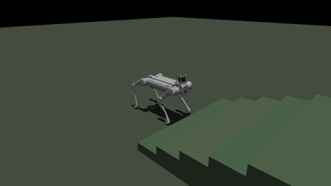

# 科研项目与 Demo 总览

机器人感知、四足运动控制、移动操作、双臂仿真与具身学习的项目资料索引。基于 2026-11-08 对本机可访问项目、实验记录、交付包和已有 GitHub 仓库的盘点。

这里收录的是可核对的研究与工程产物。源码实现、文档陈述、历史实验结果和本次实际检查分别标注；未核实论文发表、作者贡献、专利或获奖信息，因此不作相关声明。

## 快速浏览

- [全部项目的机器可读目录](catalog/projects.json)
- [6 段精选仿真 Demo 与校验信息](catalog/published_demos.json)
- [134 个本地媒体文件的目录](catalog/local_media_index.json)（含未审核实验与上游参考；不全部上传）
- [定量结果及来源](evidence/reported_metrics.json)
- [盘点范围与证据规则](SCOPE.md) · [来源与使用说明](PROVENANCE.md)

## 项目目录

| 项目 | 方向 | 现有证据 |
| --- | --- | --- |
| [OdinEye P1A：几何条件 BEV 感知](projects/odineye-p1a.md) | 视觉与空间感知 | 源码与技术说明已存档；本次未复跑训练 |
| [OdinEye P2B：双专家与尺度 Token](projects/odineye-p2b.md) | 视觉与空间感知 | 实验实现已存档；效果待核验 |
| [VGGT Method II：观测区域 BEV 与模拟器对照](projects/vggt-method2.md) | 视觉与空间感知 | 训练与推理框架已存档；本机权重未核实 |
| [B2 MuJoCo 策略验证与地形 Demo](projects/b2-sim2sim.md) | 四足运动控制 | 已有录像与六场景仿真结果 |
| [B2 Control Center：统一控制与诊断台](projects/b2-control-center.md) | 四足运动控制 | 本机代码、仿真录像与硬件诊断日志已存档 |
| [B2 + PiPER 运动策略训练与可迁移交付包](projects/b2-piper-training.md) | 强化学习与移动操作 | 已形成训练交付；楼梯增强目标未验收 |
| [ATEC Task D：B2PiPER 推箱与越障提交](projects/atec-task-d.md) | 竞赛仿真 | 多个提交方案已存档；成绩未独立核实 |
| [ATEC Task E：PiPER 桌面操作流水线](projects/atec-task-e.md) | 竞赛仿真 | 多种 baseline 与在线提交接口已存档 |
| [四类垃圾实例分割与部署导出](projects/garbage-segmentation.md) | 视觉感知 | v4 有正式训练报告与独立测试集指标 |
| [PiPER + D405 ChArUco 手眼标定](projects/d405-hand-eye.md) | 机器人标定 | 已有数学质量报告；物理工作区尚待验证 |
| [PiPER RGB-D 抓取与 Pink 规划流水线](projects/piper-grasp.md) | 机器人操作 | 已有抓取计划与多次 episode 输出；成功率未汇总 |
| [PiPER Desk 与 VLA Rollout 采集控制台](projects/piper-desk.md) | 科研工程与数据采集 | 本机源码与可迁移打包材料已存档 |
| [B2 / GNSS 与标点导航网页工具](projects/b2-gnss-console.md) | 移动机器人与导航 | 控制台交付与离线回归记录已存档 |
| [UMI Arena 杯子任务数据筛选与模型实验](projects/umi-cup-screening.md) | 具身学习与数据质量 | 已有公开方法仓库与聚合结果 |
| [双 Franka + YUBI Isaac Sim 环境](projects/dual-franka-yubi.md) | 双臂操作与仿真 | 已有公开环境与策略/录像接口 |

## 精选 Demo

下列均为 2026-08-12 的 B2 MuJoCo 仿真录像；每个场景仅一个 center replicate。已检查录像可解码与预览帧，未重新运行策略评测。视频已去除音轨和原容器元数据。

| 场景 | 预览 / 视频 | 评测摘要 |
| --- | --- | --- |
| 平地保持 | [预览](demos/flat_hold.png) · [MP4](demos/flat_hold.mp4) | [结果](evidence/flat_hold.json) |
| 平地前进 0.5 m/s | [预览](demos/flat_forward_050.png) · [MP4](demos/flat_forward_050.mp4) | [结果](evidence/flat_forward_050.json) |
| 左转 90° | [预览](demos/flat_turn_left_90.png) · [MP4](demos/flat_turn_left_90.mp4) | [结果](evidence/flat_turn_left_90.json) |
| 10° 上坡 | [预览](demos/slope_up_10.png) · [MP4](demos/slope_up_10.mp4) | [结果](evidence/slope_up_10.json) |
| 12 cm 楼梯 | [预览](demos/stairs_up_12.png) · [MP4](demos/stairs_up_12.mp4) | [结果](evidence/stairs_up_12.json) |
| 中等粗糙地形 | [预览](demos/rough_medium.png) · [MP4](demos/rough_medium.mp4) | [结果](evidence/rough_medium.json) |

六场景历史 smoke 记录为 **6/6 暂定通过、0 跌倒**；并非六场景都越过终点，也不代表实机认证。平地 0.5 m/s 试验在 8 s 计分窗口前进约 3.35 m，速度 RMSE 约 0.081 m/s。

## 有定量证据的结果

| 产物 | 记录值 | 解释边界 |
| --- | --- | --- |
| 四类分割 v4，215 张独立测试图 | mask mAP50 0.914；mAP50–95 0.792 | session 隔离内部测试；不套用其他模型版本 |
| D405 ChArUco 手眼标定 | 平移 RMS 6.5509 mm；旋转 RMS 1.2771° | 数学残差；工作区物理验证未完成 |
| UMI 杯子任务筛选 | 3975 → 3423 保留 / 552 隔离 | 来自已有公开聚合结果；不是机器人可行性认证 |

## 已有公开代码入口

- [B2 Control Center](https://github.com/zc1q84zc-boop/b2-control-center)
- [双 Franka + YUBI Isaac Sim](https://github.com/zc1q84zc-boop/dual-franka-yubi-isaac-sim)
- [UMI Arena 筛选与实验方法](https://github.com/zc1q84zc-boop/umi-arena-cup-screening-methods)

## 阅读与复现

本仓库是成果汇总和精选媒体集。各项目的完整代码、运行依赖、模型与数据按项目页指引获取；未重新分发原始数据、权重、私有骨干、第三方 SDK/资产或本机控制配置。原项目链接表示来源，不构成独立作者身份或全部原创的声明。
